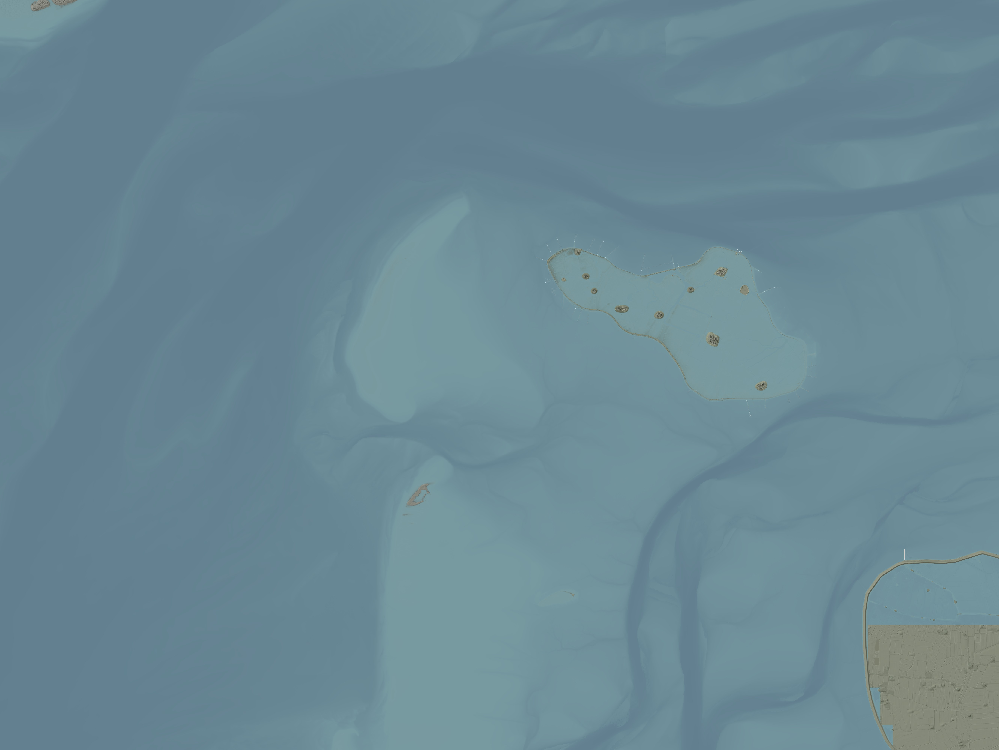
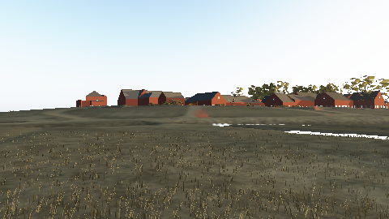
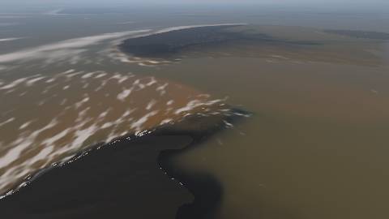
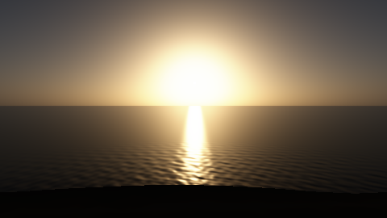
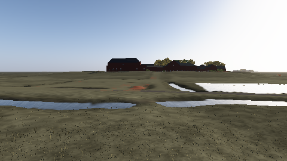

# HalligHooge



**HalligHooge** zeigt Gezeiten, Priele und Landunter um die Hallig Hooge mit dem Japsand, dem Norderoogsand und dem
Süderoogsand. Die Tide wird aus der Nordsee gerechnet; das Wasser läuft durch die Priele, über die Sände und bei Sturm
über die Kante der Hallig bis an die Warften. Dazu kommen Seegang und Brandung, Sand und Schlick, die Luft über dem
Watt, Flugsand und die Salzwiese.

Physik und Bild stammen aus dem [Renderer](https://github.com/Daniel40810/Renderer), Fenster und Bedienung aus dem
[Steuerhaus](https://github.com/Daniel40810/Steuerhaus). Dieses Projekt ist die Anwendung darüber: Szenen, Ansichten,
Regiebücher, Texte und die Werkzeuge, mit denen Kartenmaterial und Daten entstanden sind.

> Modell, nicht zur Navigation.

<table>
<tr>
<td width="50%"><br>Hanswarft von der Fenne</td>
<td width="50%"><br>Prielmündung im Ebbstrom, Sturmflut mit Sediment</td>
</tr>
<tr>
<td><br>Südwestdeich zur Sonne</td>
<td><br>Brandung an der Hanswarft</td>
</tr>
</table>

---

## Inhalt

- [Was die App zeigt](#was-die-app-zeigt)
- [Aufbau](#aufbau)
- [Voraussetzungen](#voraussetzungen)
- [Bibliotheken](#bibliotheken)
- [Bauen](#bauen)
- [Daten](#daten)
- [Starten](#starten)
- [Messarchiv (Datenbank, freiwillig)](#messarchiv-datenbank-freiwillig)
- [Werkzeuge](#werkzeuge)
- [Quellen und Lizenzen der Daten](#quellen-und-lizenzen-der-daten)

---

## Was die App zeigt

| Teil | Inhalt |
|---|---|
| Szenarien | 14 Läufe: ein ruhiger Tag (30.10.2026) und eine Sturmflut (25.10.2026), beide auch mit Seegang und mit Sediment; die Sturmflut Xaver (5./6.12.2013); ein Jahr Morphologie in drei Teilen; die Kimmung (18.10.2026); Flugsand (17.10.2026); live ab dem 29.10.2026, auch mit Sediment |
| Ansichten | Blicke in sechs Gruppen: Hallig und Warften, Landunter, Deich und Kante, Watt und Priele, Japsand und Brandung, Überblick |
| Ausstellung | Startseite mit Atlas und Infotafeln, sechs Kapitel, zwei Rundgänge (Warften, Landunter), Postkarte, Ton |
| Regiebücher | sechs Bücher im Kino (Tag, Landunter, Xaver, Strömung, Was das Wasser trägt, Luft über dem Watt) und der Gesamtfilm „Hooge“ |
| Sturmflut-Labor | zwei Läufe im Vergleich mit Schieber, Regler im Live-Lauf, das Jahr |
| Hallig-Begleiter | Tidenkalender (aus Messungen von PEGELONLINE), Landunter-Uhr, Watt-Fenster |
| Bedienung | aus dem Steuerhaus: Docks, Befehlspalette (Strg+K), Arbeitsbereiche, Messblick, Sonde, Foto, Video, Lesezeichen; F1 zeigt Tasten und Quellen |

---

## Aufbau

Die drei Projekte liegen nebeneinander in einem Ordner:

```
NetBeansProjects/
├── Renderer/      Kern, Physik, Bild, Lauf (com.dan.core, physics, render, lauf, …)   → dist/Renderer.jar
├── Steuerhaus/    Werkzeugkasten für Szenen-Apps (com.dan.steuerhaus)                  → dist/Steuerhaus.jar
└── HalligHooge/   diese App                                                            → dist/HalligHooge.jar
    ├── src/com/dan/hallighooge/   Einstieg HalligHooge.java, die Proben P0 und P2
    ├── src/szenen/                Manifest Hooge.steuerhaus, Szenen Hooge.szenen, Atlas, Kapitel, Rundgänge,
    │                              Regiebücher, Gezeiten, Watt, Vergleiche, Vorschaubilder, Programmsymbol
    ├── gebiet/Hooge.rezept        Rezept des Gebiets für die Aufbereitung (com.dan.aufbereitung im Renderer)
    ├── tools/                     Bauen, Daten umziehen, Läufe der Stufen, Kartenmaterial, Orte, Landschaft
    ├── db/                        Oracle-Schema HALLIGHOOGE für das Messarchiv: sql/ (Tabellen, Sichten), Vorlagen
    │                              für Zugang und Anlage (die App selbst braucht keine Datenbank)
    ├── lib/                       Bibliotheken – nicht im Repository
    ├── daten/                     Gebiet und Archive – nicht im Repository
    └── docs/                      Prüfberichte, Fotos, Videos – nicht im Repository
```

---

## Voraussetzungen

- Windows 10 oder 11 (x64) und eine Grafikkarte mit Vulkan 1.3; zuletzt lief die App auf einer integrierten
  AMD-Radeon-Grafik mit 44 bis 60 Bildern/s
- JDK 21 und NetBeans mit Ant (oder Ant allein)
- 16 GB Arbeitsspeicher oder mehr, die App startet mit `-Xmx12g`
- rund 17 GB Platz für die [Daten](#daten)

---

## Bibliotheken

`lib/` liegt nicht im Repository, nur die Bibliotheksdefinition von NetBeans (`lib/nblibraries.properties`,
`lib/CopyLibs/`). Vor dem Bauen gehören dorthin:

| Datei | Woher |
|---|---|
| `Renderer.jar` | aus dem [Renderer](https://github.com/Daniel40810/Renderer) gebaut (`dist/Renderer.jar`); `tools/bauen.cmd` kopiert es |
| `Steuerhaus.jar` | aus dem [Steuerhaus](https://github.com/Daniel40810/Steuerhaus) gebaut; der Bau holt es selbst aus `../Steuerhaus/dist` |
| `FStyle.jar` | Bedienelemente, liegt im Renderer unter `lib/FStyle.jar` |
| `jogl-all.jar`, `gluegen-rt.jar` und ihre `*-natives-windows-amd64.jar` | JOGL 2.6.0, liegen im Renderer unter `lib/` (Maven Central: `org.jogamp.jogl`, `org.jogamp.gluegen`) |
| `lwjgl/*.jar` | LWJGL 3.4.3 aus [github.com/LWJGL/lwjgl3/releases/tag/3.4.3](https://github.com/LWJGL/lwjgl3/releases/tag/3.4.3): `lwjgl`, `lwjgl-vulkan`, `lwjgl-vma`, `lwjgl-shaderc`, `lwjgl-jawt`, `lwjgl-glfw`, dazu je `-natives-windows` (außer bei vulkan und jawt) |
| `ojdbc11.jar` | Oracle JDBC (Maven Central: `com.oracle.database.jdbc:ojdbc11`) |
| `sdoapi.jar`, `sdogr.jar`, `sdoutl.jar` | Java-API von Oracle Spatial, aus einer Oracle-Installation (`ORACLE_HOME/md/jlib`) |

---

## Bauen

Die Reihenfolge ist Renderer → Steuerhaus → HalligHooge. Das erledigt ein Aufruf:

```bat
tools\bauen.cmd
```

`bauen.cmd` baut jedes Projekt mit `ant clean jar` und kopiert `Renderer.jar` und `Steuerhaus.jar` dorthin, wo sie
gebraucht werden. Die Projekte erwarten in NetBeans eine Java-Plattform mit dem Namen **JDK_21**
(*Werkzeuge › Java-Plattformen*). Ohne NetBeans setzt man vorher den JDK:

```bat
set "JDK21=C:\Program Files\Java\jdk-21"
tools\bauen.cmd
```

Beim Übersetzen laufen zwei Prüfungen mit: `spirv` übersetzt die Vulkan-Shader, `pruefe-importe` prüft Importe und
Umfang der App.

---

## Daten

Die App liest ein **Gebiet** (Gelände mit Subgrid, Häuser, Bewuchs, Ortsnamen) und die **Archive** der Läufe, zusammen
rund 16,6 GB. Sie liegen nicht im Repository, sondern im Ordner `daten/` neben `src/`:

```
daten/
├── gebiet/                         Gitter G0 bis G3, Gelände, Gestalt, Häuser, Bewuchs, Luftbild, Antrieb, Pegel, Orte, …
└── _p6/ _p8c/ _p9b/ _p9c/ _p13/    Archive der Läufe, verlustfrei gepackt (.f16z, .f32z)
```

Den Ort trägt `src/szenen/Hooge.szenen` in der Zeile `daten = …`; in der App lässt er sich auch
unter *Datei › Ort der Daten …* wählen (gilt nach dem nächsten Start). Ohne diese Daten lassen sich die Szenarien nicht öffnen.

So sind die Daten entstanden:

1. **Kartenmaterial** laden: `tools/kartenmaterial/kartenmaterial.py` (DGM1, bDOM, DOP20, LoD2 des LVermGeo SH,
   TrilaWatt 2021, EMODnet, GEBCO, ERA5 und weitere, siehe [Quellen](#quellen-und-lizenzen-der-daten)). Für ERA5
   braucht es einen eigenen Zugang zum Climate Data Store in `%USERPROFILE%\.cdsapirc`.
2. **Aufbereitung** zum Gebiet: `com.dan.aufbereitung` im Renderer mit dem Rezept `gebiet/Hooge.rezept`.
3. **Läufe** rechnen: die Skripte `tools/lauf_P*.cmd` im Renderer schreiben die Archive.
4. **Umzug** in die App: `tools/daten_umziehen.cmd` packt die Archive verlustfrei, kopiert das Gebiet, prüft jeden
   Stand gegen das Original und stellt `daten =` um; `tools/daten_zurueck.cmd` stellt zurück.

---

## Starten

```bat
HalligHooge.cmd
```

```bat
HalligHooge.cmd --szenario sturm
```

Die Namen der Szenarien stehen in `src/szenen/Hooge.szenen` (`ruhig`, `sturm`, `seegang`, `sediment`, `xaver`, `live`,
`morpho`, `kimmung`, `flugsand`, …).

Ein Abbild mit eigener Java-Laufzeit (`dist/abbild/HalligHooge/HalligHooge.exe`) baut das Steuerhaus mit jpackage:

```bat
..\Steuerhaus\tools\abbild.cmd "%CD%" HalligHooge 2.3.0
```

Die Daten gehören nicht ins Abbild; es liest sie aus dem Ordner, den `daten =` nennt.

---

## Messarchiv (Datenbank, freiwillig)

PEGELONLINE gibt den Wasserstand nur 30 Tage rückwirkend her. Das Messarchiv hält ihn fest: Ein Sammler ohne Fenster
(`com.dan.steuerhaus.messung.Sammler`) holt jede Stunde die Minutenwerte der 22 Pegel des Gebiets und einmal am Tag den
Wind des DWD (Helgoland, List) in ein Oracle-Schema `HALLIGHOOGE` (Präfix `HH_`, Lage in ETRS89 / UTM 32, SRID 25832).
Daraus werden 10-Minuten-Mittel, Hoch- und Niedrigwasser mit Windstau, Sturmfluten nach den Klassen des BSH und, für
den Anleger Hooge ohne eigenen Pegel, das geschätzte Hochwasser mit Landunter (Gezeit aus dem Tidenkalender plus
Windstau an Pellworm Anleger und Wittdün, wie die Landunter-Uhr). **Die App läuft ohne Datenbank:** Was das Archiv findet,
steht seit DB2 in der Chronik `src/szenen/Hooge.chronik` (Landunter, Wasser über der Krone, Sturmfluten), die der Sammler
nur bei einem neuen Ereignis neu schreibt; die App liest nur diese Datei. Seit DB3 misst das Archiv auch das Modell:
`src/szenen/Hooge.guete` stellt den Wasserstand der App an sieben Pegeln neben die Messung, je Lauf der Szenarien
(Kurven, Hoch- und Niedrigwasser, RMSE, Bias, Skill, Windstau; bei Xaver das höchste Tidehochwasser HThw).

| Teil | Inhalt |
|---|---|
| `db/sql/01_tabellen.sql` … `04_startdaten.sql` | Schema: Stationen, Konstanten der Gezeit, Schwellen, Orte, Minutenwerte, Mittel, Scheitel, Protokoll; Sichten `HH_STATION_V`, `HH_FUELLSTAND_V`, `HH_HOCHWASSER_V`, `HH_STURMFLUT_V`, `HH_SCHAETZUNG_V`, `HH_LANDUNTER_V`; seit DB3 Läufe, Reihen und Scheitel des Modells, Kennzahlen (`HH_LAUF`, `HH_MODELL`, `HH_MODELL_SCHEITEL`, `HH_GUETE`) mit `HH_VERGLEICH_V`, `HH_SCHEITEL_PAAR_V`, `HH_GUETE_V` |
| `messung.*` in `src/szenen/Hooge.steuerhaus` | Zugang, Aufbewahrung, Grenze, Quellen, Ort |
| `guete.*` in `src/szenen/Hooge.steuerhaus` | seit DB3: Pegel, Umkreis der Zelle, Einschwingen, Windstau, Dateien |
| `tools/lauf_DB1.cmd` | einmal: bauen, prüfen, Schema einrichten, Bestand aus `daten/gebiet` übernehmen, erster Abruf, Aufgabe anlegen |
| `tools/sammler_aufgabe.cmd` | die stündliche Aufgabe „HalligHooge Messarchiv“ anlegen (`aus`: entfernen) |
| `tools/sammler.cmd` | von Hand: `--bericht`, `--abruf`, `--pflege --nur-plan`, `--pruefen --gebiet daten\gebiet`, `--chronik`, `--wind-nachladen`, `--guete` |
| `src/szenen/Hooge.chronik` | seit DB2: die Chronik der Hochwasser, vom Sammler geschrieben, nur wenn ein Ereignis dazukommt; die App zeigt sie unter Labor › Chronik der Hochwasser (Strg Umschalt H) und unter der Landunter-Uhr |
| `tools/lauf_DB2.cmd` | DB2: Chronik, Wind 2020 bis 2025, Füllstand je Tabelle, Abbild 2.4.0 |
| `src/szenen/Hooge.guete` | seit DB3: Modell gegen Messung, vom Sammler geschrieben (nur bei Änderung); die App zeigt es unter Labor › Modell gegen Messung (Strg Umschalt M) |
| `daten/guete/Hooge.modell` | seit DB3: der Wasserstand des Modells an den Pegeln, aus den Archiven gelesen (`Ausgabe --guete`); bleibt lokal bei den Daten |
| `tools/lauf_DB3.cmd` | DB3: Schema Stufe 3, HThw, Archive lesen, Kennzahlen, Abbild 2.5.0 |

**Modell gegen Messung (DB3).** Wenn ein Archiv neu gerechnet ist: `Ausgabe --guete` (liest je Archiv und Pegel nur die
Zelle, rund eine Sekunde je Archiv), dann `tools\sammler.cmd --guete`. Der Sammler ersetzt einen Lauf nur, wenn sich
seine Kennung (SHA-256 über die Reihen des Modells) ändert, und schreibt `Hooge.guete` nur bei Änderung.

**Wachstumsgrenze.** Nur der Sammler lässt die Datenbank wachsen, darum räumt er bei jedem Lauf selbst auf. Die
Minutenwerte liegen in Monatsfächern (Partitionen nach Intervall) und fallen nach `messung.roh.monate` (6) als Ganzes
weg; ihre 10-Minuten-Mittel, die Scheitel und die Ereignisse bleiben. Über `messung.grenze.mb` (1 500 MB) fallen
weitere Fächer, das älteste zuerst (nie der laufende und der vorige Monat, nie das laufende Jahr); reicht das nicht,
fügt der Sammler nichts mehr ein und meldet es. Das Protokoll der Abrufe bleibt `messung.abruf.tage` (400) Tage,
die Protokolldatei `%USERPROFILE%\.steuerhaus\HalligHooge\sammler.log` höchstens 1 MB (dann eine Stufe zurück).

**Einrichten.** Das Schema einmal als Admin anlegen (`db/USER.sql`, Vorlage `db/USER.sql.example`, mit
`GRANT CREATE TABLE, CREATE SEQUENCE TO HALLIGHOOGE` für die räumlichen Indizes), `db/db.properties` aus der Vorlage
(das Passwort fragt der Sammler einmal und trägt es ein), dann `tools\lauf_DB1.cmd`.

---

## Werkzeuge

| Datei | Zweck |
|---|---|
| `tools/bauen.cmd` | Renderer, Steuerhaus und HalligHooge der Reihe nach bauen |
| `tools/daten_umziehen.cmd`, `tools/daten_zurueck.cmd` | die Daten in das Projekt holen und zurückstellen |
| `tools/lauf_X1.cmd` … `tools/lauf_DB3.cmd` | Läufe der Stufen mit Prüfungen; sie schreiben nach `docs/status` |
| `tools/sammler.cmd`, `tools/sammler_aufgabe.cmd` | Messarchiv: Sammler von Hand, stündliche Aufgabe |
| `tools/kartenmaterial/` | Laden des Kartenmaterials, mit den Indizes der Massendownloads des LVermGeo SH |
| `tools/orte/orte.py` | Ortsnamen aus OpenStreetMap für die Einblendungen |
| `tools/landschaft/landschaft.py` | Farbe der Hänge aus Sentinel-2 |
| `tools/*.java` | Werkzeuge des Baus und der Prüfung: SPIR-V, Importe, Jars, Bild- und Waldvergleich |
| `tools/github_G1.cmd` | so sind die drei Repositories angelegt worden |

---

## Quellen und Lizenzen der Daten

Wortlaut aus `src/szenen/Hooge.steuerhaus`, in der App unter F1:

- DGM1, bDOM, DOP20, DTK5, DTK25 und 3D-Gebäudemodell LoD2: © GeoBasis-DE/LVermGeo SH/CC BY 4.0
- Watt und Sände (TrilaWatt 2021), Bathymetrie, Kennwerte und Sedimentologie (EasyGSH-DB): Quellenvermerk: Bundesanstalt für Wasserbau 2026 (CC BY 4.0); nicht für die Navigation
- Wetter, Seegang und Strahlung: ERA5, Copernicus Climate Change Service (C3S), ECMWF; enthält modifizierte Copernicus-Daten
- Gelände außerhalb Schleswig-Holsteins: Copernicus DEM GLO-30, © DLR e.V. 2010–2014 und © Airbus Defence and Space GmbH 2014–2018, bereitgestellt im Rahmen des Copernicus-Programms
- Satellitenbilder: enthält modifizierte Copernicus-Sentinel-Daten (Sentinel-2, 2024–2026)
- Bathymetrie der Nordsee: EMODnet Bathymetry Consortium, EMODnet Digital Bathymetry (DTM); GEBCO Compilation Group, GEBCO 2025 Grid
- Gezeiten am Rand: EOT20, Hart-Davis u. a. (2021), CC BY 4.0
- Pegel: PEGELONLINE, Wasserstraßen- und Schifffahrtsverwaltung des Bundes (WSV), DL-DE Zero 2.0
- Wind an Land: Quelle: Deutscher Wetterdienst (CC BY 4.0)
- Küste und Szene: © OpenStreetMap-Mitwirkende (ODbL 1.0); Natural Earth (gemeinfrei)

`Werkbuch.pdf` ist die erste Fassung des Werkbuchs, nach dem das Projekt in Stufen gebaut wurde.
